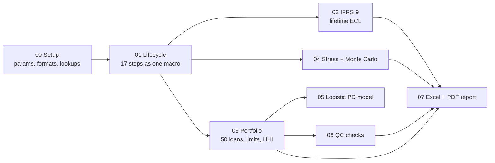

# Prestige City Bengaluru - Infrastructure Credit Risk in SAS

An end-to-end **project-finance credit risk lifecycle** built in SAS: a hypothetical Rs 7,000 Crore
loan for a large residential township, followed from origination to recovery, then extended into
IFRS 9 lifetime ECL, a 50-loan portfolio, stress tests, Monte Carlo simulation, a logistic PD model,
automated QC and an Excel + PDF management report.

> **Disclaimer** - Educational case study. All borrower figures, ratings, loan terms and the
> synthetic portfolio are **hypothetical**. They do not describe any real loan, bank or company.

## Pipeline



## The 17 lifecycle steps (`sas/01_project_lifecycle.sas`)

Origination -> Due diligence -> Feasibility -> Financial model -> DSCR / LLCR / PLCR -> Internal rating
-> PD -> Approval authority -> Structuring -> Consortium -> Milestone disbursement -> Construction
monitoring -> Early-warning system -> IFRS 9 ECL -> Portfolio monitoring -> Restructuring -> Default and recovery.

All 17 steps live in one macro, `%run_lifecycle(inds=, outds=)`. It scores **one project or a thousand**, which is
how the same logic powers the portfolio (03) and stress-test (04) modules.

## How to run

1. Copy this folder to your SAS environment (SAS OnDemand for Academics, SAS Studio, EG or Viya).
2. Open `sas/main.sas` and edit the single `ROOT` line to the folder path.
3. Run `main.sas`. Output tables go to `data/`, reports to `output/`.

Needs Base SAS, SAS/STAT (PROC LOGISTIC, SURVEYSELECT) and ODS Graphics (PROC SGPLOT). ODS EXCEL needs SAS 9.4 M3 or later.
`sas/08_cas_viya_optional.sas` is separate and needs SAS Viya.

## Expected result for the Prestige base case

| Metric | Value |
|---|---|
| DSCR / LLCR / PLCR | 1.50 / 1.71 / 2.00 |
| Rating, 12-month PD | AA, 1% |
| LGD, EAD | 35%, Rs 7,000 Cr |
| Simple ECL (PD x LGD x EAD) | Rs 24.5 Cr, IFRS 9 Stage 1 |
| Approval authority | Board Credit Committee |
| Early-warning flag, decision | NO, APPROVE |
| Outstanding after Rs 300 Cr principal repaid | Rs 6,700 Cr |

These were hand-checked outside SAS. If your log shows different numbers, the logic is the thing to debug.

## Changes versus the original script

| Area | Original | Now |
|---|---|---|
| Structure | 17 separate data steps, hard-coded | One parameterised macro, thresholds in `00_setup.sas` |
| PLCR | Same formula as LLCR (always identical) | Uses PV over the full project life |
| Outstanding balance | 7,000 even after 300 principal collected | Disbursed less principal collected = 6,700 |
| Recovery base | Sanctioned debt | Outstanding balance, plus discounted recovery (economic loss) |
| Disbursement | Five hard-coded amounts | Milestone percentages, driven by milestones achieved |
| Approval | One threshold (7,000) | Four-tier delegated-authority matrix |
| EAD | Sanctioned debt | Drawn + CCF x undrawn |
| IFRS 9 | Single ECL figure | Stage 1/2/3 allocation, lifetime ECL, 3 weighted scenarios |
| EWS | Flag only | Counts triggers and writes the reasons in plain English |

## A finding worth discussing

The case supplies annual debt service of Rs 1,000 Cr. The stated loan terms (10% interest, 3-year
moratorium, equal principal over 12 years) imply a peak of about Rs 1,283 Cr in year 4, so DSCR on peak
debt service is about 1.17, below the 1.20 early-warning trigger. `02_ifrs9_ecl.sas` prints this
check (`cr.peak_dscr_check`). It is a good example of why input data should be reconciled to the structure.

## SAS concepts demonstrated

See [`docs/CONCEPTS_COVERED.md`](docs/CONCEPTS_COVERED.md) for the full file-by-file map.

## Repository layout

```
sas/       00_setup ... 08_cas_viya_optional, main.sas
docs/      CONCEPTS_COVERED.md
data/      SAS datasets are written here (git-ignored)
output/    Excel and PDF reports are written here (git-ignored)
logs/      optional run logs (git-ignored)
```

## License

MIT - see [LICENSE](LICENSE).
